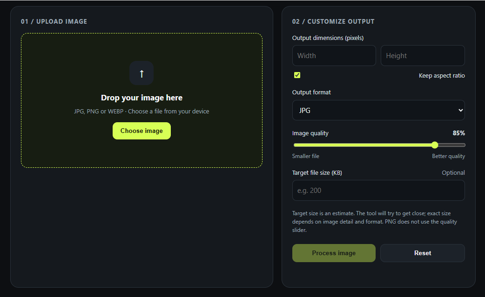

# PixelFit – Image Resizer & Compressor         

PixelFit is a simple, browser-based image resizing and compression tool built using HTML, CSS, and JavaScript.

It allows users to upload images, customize dimensions, compress file sizes, and download processed images.

## Features

- Upload images using drag and drop or file selection.
- Increase or decrease image dimensions.
- Maintain original aspect ratio.
- Compress images by adjusting quality.
- Set a target file size in KB.
- Convert images into JPG, PNG, and WEBP formats.
- Preview processed images before downloading.
- Download the final processed image.

## Technologies Used

- HTML5
- CSS3
- JavaScript
- Canvas API

## How to Use

1. Download or clone this repository.
2. Open `pixelfit-image-resizer.html` in your browser.
3. Upload an image.
4. Set your desired width and height.
5. Select the output format and quality.
6. Click **Process Image**.
7. Preview and download your image.

## Privacy

PixelFit processes images directly in your browser. Images are not uploaded to an external server.

## Project Structure

```text
PixelFit/
│
└── pixelfit-image-resizer.html
```

## preview


